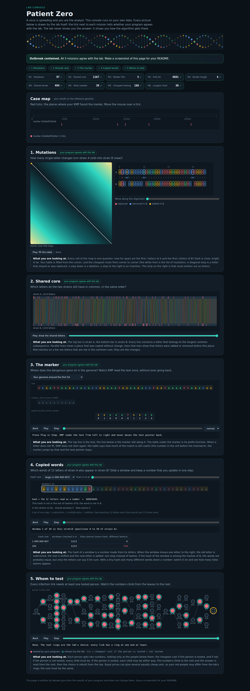

# Assignment 4. Patient Zero

Student ID: PENDING
Name: PENDING
Group: PENDING

**Status:** The five algorithms are implemented and checked. Personal data, personal output, the marker-specific answer and the final screenshot are pending the student's exact Moodle ID. This draft is not ready for submission yet.

## Run and personalize

Java 17 or newer (JDK) is required. Run commands from the `patient-zero` folder.

```bash
java tools/Check.java
java -cp out tools/SelfTest.java
java tools/Prepare.java YOUR_STUDENT_ID "YOUR NAME" "YOUR GROUP"
```

`Prepare` generates the four personal files, compiles the sources, runs Main and fills in the identity, program output and personal marker border below. It does not create a screenshot. Open `output/outbreak.html`, check the nine green ticks and save a full-page screenshot as `output/outbreak.png`. Review this report and explain the answers in your own words before submission.

Regular compilation and execution:

```bash
javac -encoding UTF-8 -d out src/*.java
java -cp out Main
java -cp out Bench
```

## Program output

<!-- OUTPUT START -->
Pending: run Prepare with the exact Moodle Student ID. No example results are presented as personal results.
<!-- OUTPUT END -->

My outbreak report (add the personal screenshot before submission):



## Questions

### Mission 1

`d[i][j]` is the minimum number of edits needed to turn the first `i` letters of A into the first `j` letters of B. The first column is `i` deletions and the first row is `j` insertions. Each other cell is the minimum of deleting a letter (`d[i-1][j]+1`), inserting one (`d[i][j-1]+1`), or matching/replacing the last letter (`d[i-1][j-1]` plus 0 or 1).

### Mission 2

A common subsequence keeps the letter order but may skip letters; a common substring must be contiguous in both strings. For example, `AGT` is a subsequence of `ACGTT`, but is not a substring of it. The shared core can be longer than the number of equal letters at identical positions because insertions and deletions shift matching letters, while LCS still matches them in order.

### Mission 3

`pi[i]` is the length of the longest proper prefix of the marker prefix ending at `i` that is also its suffix. After a mismatch, KMP uses `pi[j-1]` to retain the longest useful part of the letters already matched; it changes the marker pointer while the text pointer continues forward. The final prefix-function value is the marker's Border length, and after a full match this same fallback preserves overlapping occurrences.

<!-- BORDER START -->
Personal marker border: PENDING Student ID.
<!-- BORDER END -->

### Mission 4

Different words can have the same numeric hash, so equal hashes only identify candidates: the code compares their letters to confirm a match. Each hash bucket stores every B-window position, so a false candidate does not hide a later real match, and each A position is counted only once. If many different windows collide, many length-k comparisons are needed and the worst-case time becomes O(a*b*k), although the rolling-hash update itself remains O(1).

### Mission 5

`dp[v][0]` is the minimum cost in v's subtree when v is not tested, and `dp[v][1]` is the minimum when v is tested. An untested v forces each child to be tested, so `dp[v][0] = sum(dp[c][1])`; a tested v allows either child state, so `dp[v][1] = cost[v] + sum(min(dp[c][0],dp[c][1]))`, and the root answer is the minimum of its two states. Greedy selection by degree can fail: in a three-person path with costs 1,100,1, choosing the middle costs 100, while testing both endpoints covers both edges for 2.

The code reconstructs the actual people by following the chosen states from root 0. Calling the same method with all costs equal to 1 minimizes the number of tests. For the longest chain, a DFS keeps the two longest downward paths at each vertex and maximizes their sum, counting edges rather than vertices.

## AI use

ChatGPT (Codex) was used to explain the assignment, implement the five algorithm missions, prepare this README, add a personalization helper, and run validation. The included implementation commits were created by Codex Assistant during this session; they are not a record of independent student authorship. This is an AI-assisted draft: the student must review, understand and, as required by the assignment, revise it before submission, including rewriting these explanations in their own words. No independent student review is claimed here.

`Main.java`, `Input.java`, `Render.java`, `Generator.java`, `Bench.java`, `src/lab.html`, the provided examples and original teaching documents come from the supplied course starter and were kept unchanged.

## Timing (Mission 7)

Measured by running the original `java -cp out Bench` on OpenJDK 17 in the preparation environment; each number is the average of three runs, in milliseconds. These are measured values, not theoretical estimates; results on another computer will differ.

| test | size | time (ms) |
|---|---|---|
| naive search | 20,000 / 40,000 / 80,000 | 10.7 / 12.4 / 23.9 |
| KMP | 20,000 / 40,000 / 80,000 | 2.5 / 1.1 / 0.4 |
| edit distance | 500 / 1,000 / 2,000 / 4,000 | 5.5 / 7.1 / 11.6 / 37.2 |

With the pattern length fixed, both search times are expected to grow approximately linearly with text length, but the naive loop performs many more comparisons on this input; generally it costs O(n*m), whereas KMP costs O(n+m). Doubling both edit-distance string lengths creates about four times as many table cells, so its theoretical running time is quadratic. These short measurements include JVM warm-up, JIT compilation, allocation and scheduling effects, explaining the decreasing KMP measurements and deviations from exact doubling or quadrupling; they do not establish an empirical scaling law by themselves.

## Complexity

`a` and `b` are strain lengths, `n` is genome/text length, `m` is marker length, `k` is the window length (12 here), `h` is the number of search hits, `C` is the number of candidate window comparisons, and `v` is the number of people. Space excludes input storage but includes returned results; recursion depth may be O(v).

| algorithm | time | space | assumptions |
|---|---|---|---|
| Edit distance | O((a+1)(b+1)) | O((a+1)(b+1)) | Full DP table, unit edit costs |
| LCS | O((a+1)(b+1)) | O((a+1)(b+1)) | Full DP table, subsequence may skip letters |
| Prefix function and KMP | O(n+m) | O(m+h) | Prefix table and returned match positions; h <= n+1 |
| Rabin-Karp (shared words) | O(a+b+k+C*k); worst O(a*b*k) | O(b) | Positive k; non-short input strings; expected O(1) HashMap operations; few false hash collisions for the usual fast case; all candidate matches verified |
| Tree DP, reconstruction and diameter | O(v) | O(v) | Connected tree rooted at 0; adjacency lists; each edge visited a constant number of times |

For Rabin-Karp, with k=12 fixed and few false candidates, the usual time is O(a+b); exact comparisons still take up to k character checks each. Window hashes use a manually implemented polynomial rolling hash; no library string-search or content-hashing function is used by the missions.

## Validation

- Original `Check.java`: tiny, small and dense all pass all nine output lines (27/27).
- Additional `SelfTest.java`: empty/overlapping cases, a real polynomial-hash collision and a later matching candidate in the same bucket.
- 1,000 seeded random string cases: KMP against a direct character scan, prefix function against exhaustive borders, shared words against a direct scan, and LCS against enumeration of subsequences.
- 300 seeded random trees: DP solutions against every subset with both real and unit costs, checking that all edges are covered; diameter against BFS from every vertex.
- Personal-ID validation and the personal lab screenshot: pending.

## Before submission

- Supply the exact Student ID, name and group; run Prepare.
- Open the personal lab console, verify all nine ticks, and add `output/outbreak.png`.
- Read and revise the AI-assisted implementation and report as required by the assignment.
- Ensure all four personal `data/*.txt` files, sources and screenshot are tracked.
- Run Check, SelfTest and Main again; run Bench on your own machine if updating the timing table.
- Push the included main branch with its real commit history to a public GitHub repository.
- Submit the public repository link in Moodle before its deadline.
